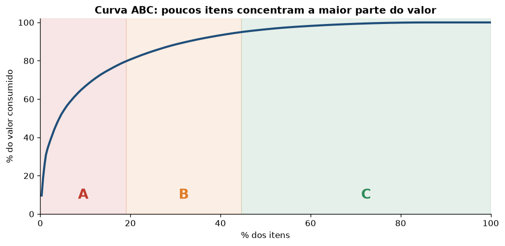
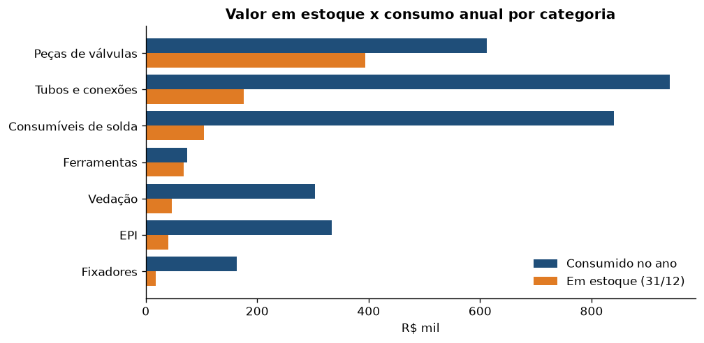
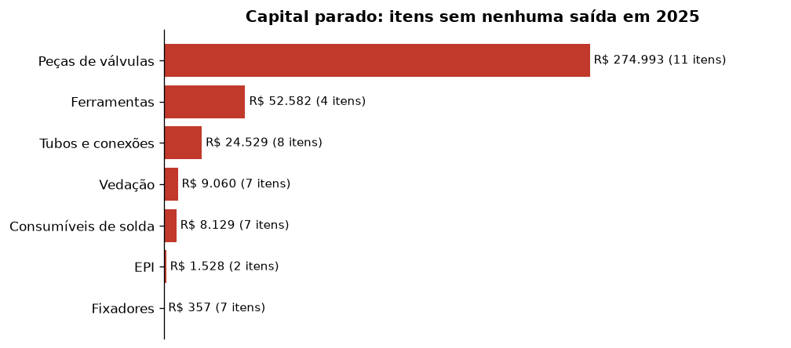
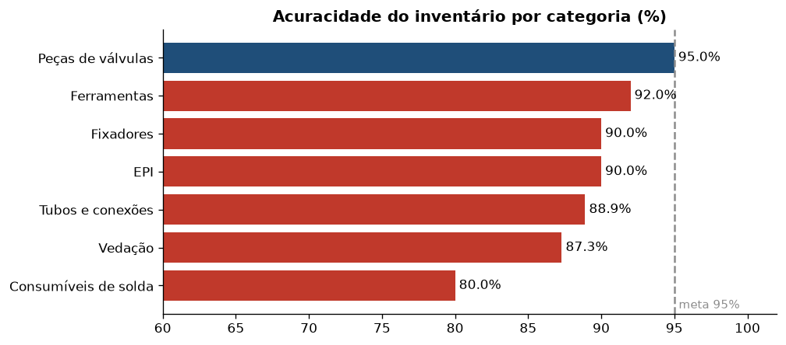

# 📦 Análise de Estoque de Almoxarifado: Curva ABC, Giro e Acuracidade

Diagnóstico do estoque de um **almoxarifado industrial** (fixadores, vedação, consumíveis de solda, tubos, peças de válvulas, EPI e ferramentas), com **SQL, Python e Power BI**.

> ⚠️ **Dados fictícios.** A base (320 materiais, ~27 mil movimentações e um inventário físico) foi gerada por script (`src/gerar_dados.py`) para reproduzir situações reais de almoxarifado. Nenhuma informação pertence a uma empresa real.

---

## 🎯 Problema de negócio
1. **Onde está o dinheiro?** Quais itens concentram o valor consumido (curva ABC)?
2. **O estoque está dimensionado?** Quanto tempo o estoque atual cobre por categoria?
3. **Existe capital parado?** Quais itens não tiveram nenhuma saída no ano?
4. **O sistema é confiável?** Qual a acuracidade do inventário (físico x sistema)?

## 🧰 Ferramentas
| Etapa | Ferramenta |
|---|---|
| Geração e tratamento dos dados | Python (pandas, numpy) |
| Modelagem e consultas | SQL (SQLite): CTEs, funções de janela, `NOT EXISTS`, `LEFT JOIN` |
| Visualização | Matplotlib · Power BI (medidas DAX em [`powerbi/medidas_dax.md`](powerbi/medidas_dax.md)) |

## 🗂️ Estrutura
```
├── data/            # materiais.csv, movimentacoes.csv, inventario.csv
├── sql/
│   ├── 01_schema.sql      # modelo de dados (3 tabelas relacionadas)
│   └── 02_analises.sql    # ABC, giro, cobertura, obsoletos, acuracidade
├── src/
│   ├── gerar_dados.py     # gera a base fictícia
│   └── analise.py         # roda o SQL e gera os gráficos
├── powerbi/medidas_dax.md
└── img/
```

## 📈 Resultados (2025)
| Valor em estoque | Consumo anual | Cobertura média | Acuracidade | Capital parado |
|---|---|---|---|---|
| R$ 846 mil | R$ 3,27 mi | 3,1 meses | **89,4%** (meta 95%) | **R$ 371 mil** em 46 itens |

### 1. Curva ABC: 19% dos itens = 80% do valor

| Classe | Itens | % itens | % valor consumido |
|---|---|---|---|
| A | 61 | 19,1% | 79,8% |
| B | 82 | 25,6% | 15,2% |
| C | 177 | 55,3% | 5,0% |

Os **61 itens classe A** devem ter controle mais rigoroso: contagem cíclica mensal, revisão de estoque mínimo e negociação com fornecedores.

### 2. Peças de válvulas e ferramentas têm estoque alto demais

A maioria das categorias cobre de 1 a 2 meses de consumo, mas **peças de válvulas cobrem 7,7 meses** e **ferramentas, 11,1 meses**.

### 3. R$ 371 mil sem nenhuma saída no ano

**46 itens** não tiveram saída em 2025. Só as **peças de válvulas paradas somam R$ 275 mil (74%)**.

### 4. Acuracidade abaixo da meta

Apenas peças de válvulas atingem 95%. **Consumíveis de solda (80%)** e vedação (87,3%) são os piores, porque são itens de alto giro e retirada fracionada.

## 💡 Recomendações
1. **Capital parado:** revisar os 46 itens sem giro com a engenharia, devolver ao fornecedor, vender ou baixar como obsoleto. Bloquear novas compras desses códigos.
2. **Peças de válvulas:** recalcular o estoque mínimo pelo consumo real e passar itens caros de baixo giro para compra sob demanda.
3. **Inventário cíclico:** contar mensalmente os itens A e os consumíveis de solda, e trimestralmente os itens B e C.
4. **Consumíveis de solda:** padronizar a requisição por kit ou embalagem fechada, para reduzir a retirada fracionada.
5. **Ruptura:** 3 itens fecharam o ano abaixo do mínimo. Criar um alerta automático de reposição.

## ▶️ Como executar
Os dados e os gráficos são gerados **automaticamente pelo GitHub Actions** (`.github/workflows/gerar.yml`) a cada alteração no código, o que garante que a análise é reproduzível. Para rodar localmente:
```bash
pip install -r requirements.txt
python src/gerar_dados.py   # (opcional) regenera a base
python src/analise.py       # roda as consultas e gera os gráficos
```

---
👤 **Domingos Morato**: PCP & Análise de Dados · [LinkedIn](https://www.linkedin.com/in/domingos-morato)
